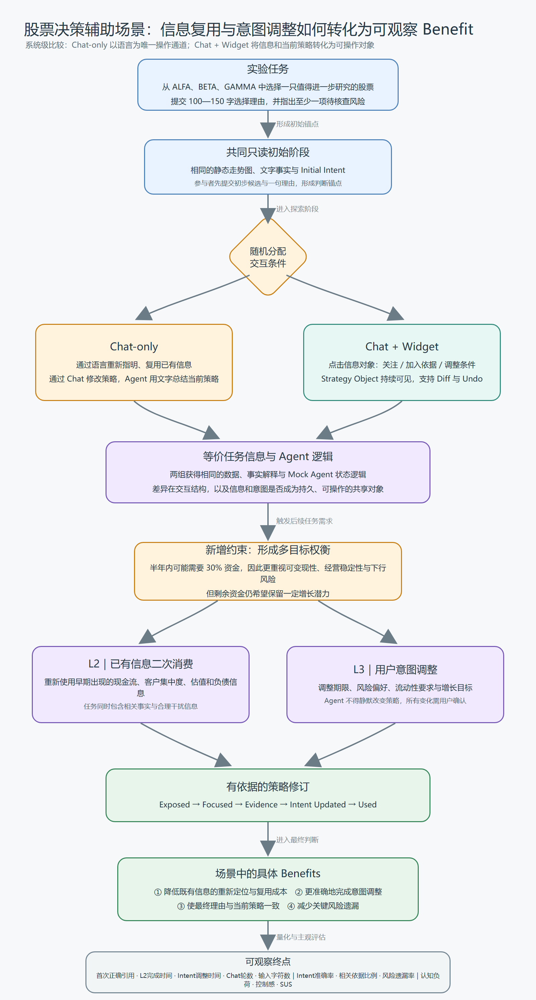

# 股票决策辅助场景 Demo V2.0

> 状态：实验设计修订稿  
> 日期：2026-08-23  
>
> 配套材料：[股票场景实验剧本 V1.1](stock-experiment-script-v1.md)
## 1. 研究定位

### 总体 Claim

在多轮、高信息密度的复杂任务中，相比以 Chat 作为唯一交互通道，在 Chat Lane 中嵌入可指点、可操作的 Widget，可以降低既有信息二次消费和用户意图调整的交互成本，从而提升人机协作效率。

股票场景验证 Chat + Widget 这一整体交互范式，不对 Popup、视觉显著性、Strategy Object、Diff 或 Undo 的独立贡献做因果归因。

任务正确性作为实验评价约束：效率提升不应以牺牲 Intent 准确性、信息复用质量或最终理由一致性为代价；它不属于总体 Claim 的新增内容。

### 研究重心

- **主要结果：** 信息复用与意图调整的交互效率和正确性。
- **次要结果：** 认知负荷、控制感和关键风险遗漏。
- **不研究：** 真实股票预测、专业交易绩效、AI 生成 GUI 或自动识别 Object。

```text
Chat + Widget
→ 信息与意图成为可寻址、可持续、可操作的共享对象
→ 减少回溯、重述、澄清与状态确认
→ 信息复用和意图调整效率提升
→ 可能进一步降低认知负荷和风险遗漏
```

## 2. 实验流程图



## 3. 目标用户与实验任务

目标用户为具备基本股票概念、但不具备专业分析能力的普通投资者。所有股票、数据与事件均为虚构且固定，Agent 使用确定性的 Mock 逻辑。

基础任务为：

> 在 ALFA、BETA、GAMMA 三只虚构股票中，选择一只值得进一步研究的股票，并提交 100—150 字选择理由和至少一项待核查风险。

### 3.1 初始目标

```text
投资期限：约一年
风险偏好：适中
目标：兼顾增长与稳定
```

### 3.2 候选信息结构

| 股票 | 优势信息 | 风险信息 |
|---|---|---|
| ALFA | 增长最快、流动性较好 | 估值较高、最大客户收入占比 42% |
| BETA | 现金流稳定、下行波动较低 | 增长较慢、行业周期敏感 |
| GAMMA | 增长与估值相对均衡 | 负债较高、政策变化敏感 |

任务材料中预设：

- 3—4 条与后续决策相关的早期事实；
- 2—3 条看似合理但与新约束无关的干扰事实；
- 可计算的目标 Intent 字段；
- 最终理由的证据评分标准。

### 3.3 后续约束

在完成数轮探索、使早期信息离开当前视野后，加入新的任务约束：

> 你半年内可能需要使用 30% 的资金，因此现在更重视可变现性、经营稳定性和下行风险；但剩余资金仍希望保留一定增长潜力。

这个变化不会直接决定唯一正确股票。用户必须组合多个早期事实，更新当前策略并说明取舍。

最终股票选择允许存在合理差异；实验主要判断用户是否：

- 正确更新了目标 Intent；
- 复用了与新 Intent 相关的已有信息；
- 避免把无关事实当作主要依据；
- 提交了与当前策略一致的理由；
- 识别了候选股票中的关键风险。

## 4. 信息呈现

两组均获得相同的股票数据、事实解释和 Mock Agent 逻辑。

### Graph

Chat 中的静态 Graph 只展示候选股票的价格走势、相对变化和基本波动，不承载完整指标仪表盘。两组看到完全相同的 Graph。

### 文字信息与信息对象

估值、现金流、客户集中度和业务风险通过自然语言描述。系统内部将关键事实定义为独立信息单元：

```text
ALFA / 客户集中度 / 42%
ALFA / 估值 / 较高
BETA / 经营现金流 / 稳定
GAMMA / 负债 / 较高
```

Widget 条件下，这些信息单元成为可指点的信息对象；Chat-only 条件下，用户必须通过语言重新指明和复用它们。

## 5. Strategy Object

“当前策略”被定义为一种抽象、持久、可更新的业务对象：

```text
Strategy Object · V2

目标：兼顾稳定与增长
期限：6 个月
风险偏好：中低
策略条件：
  ✓ 重视经营现金流稳定性
  ✓ 降低客户集中度风险
  ✓ 保留一定增长潜力

决策依据：
  BETA 现金流稳定
  ALFA 最大客户收入占比 42%
```

Strategy Object 具有：

- 结构化字段：目标、期限、风险偏好和策略条件；
- 版本状态：V1、V2 等；
- 证据关系：条件可追溯至相关信息对象；
- 明确操作：编辑、加入条件、删除、Diff 和 Undo；
- 用户控制：Agent 不得静默修改，所有变化必须经用户确认。

Strategy Object 只出现在 Chat + Widget 条件中。Chat-only 中，Agent 以语义等价的文字消息总结当前策略。

因此，本研究比较的是两种完整交互范式，Strategy Object 的持续可见、状态外化和直接操作均属于 Widget 介入的一部分。

## 6. 最小 Widget 交互

第一版实验只保留三个核心操作：

1. **关注：** 以后可能继续使用这条信息。
2. **加入依据：** 本次判断明确考虑这条信息。
3. **调整条件：** 将信息转化为影响 Agent 后续分析的策略条件。

信息 Popup 示例：

```text
客户集中度：42%

主要客户变化可能影响公司收入稳定性。

[关注] [加入依据] [调整相关条件]
```

备注作为“关注”后的可选补充，不单独占据主按钮；完整日志仅在后台记录；Agent Suggestions 不进入第一版主实验。Diff 与 Undo 作为 Strategy Object 的状态反馈保留。

状态转换为：

```text
Source Information
→ Focused
→ Confirmed Evidence
→ Intent Updated
→ Used in Agent Output
```

Highlight 或查看信息不自动等于意图变化。只有用户明确加入依据或确认条件修改，才会影响 Agent 后续输出。

## 7. 实验条件

| 功能 | Chat-only | Chat + Widget |
|---|---|---|
| Mock Agent 与股票信息 | 相同 | 相同 |
| 静态走势图 | 相同 | 相同 |
| 文字指标和风险 | 相同 | 相同 |
| 查看补充解释 | 通过 Chat 追问 | 点击信息对象 |
| 关注和复用信息 | 通过 Chat 重新指明 | 关注 / 加入依据 |
| 当前策略载体 | Agent 在 Chat 中用文字总结 | 持久 Strategy Object |
| 调整策略 | 通过 Chat 描述并确认 | 直接编辑，也可以通过 Chat |
| 策略依据追溯 | 回溯历史 Chat | 从策略条件跳转至来源信息 |
| 修改反馈 | Agent 文字确认 | Object Diff 与 Agent 解释 |
| 撤销 | 通过 Chat 提出 | 直接 Undo |

Chat-only 指 Chat 是唯一操作通道，不表示界面只能包含纯文字。两组可以包含相同的静态 Graph，但 Chat-only 不提供可操作的信息对象或 Strategy Object。

实验运行时，Round 00—03 先作为两组相同的只读历史呈现，Round 04 使用相同输入提交初步候选；随后才激活条件化交互并展示新约束。这样可以确保初步判断不受 Widget 影响，主要比较集中在后续信息复用和意图调整阶段。

## 8. 多轮实验剧本

1. **建立初始意图：** 用户确认一年期、风险适中、兼顾增长与稳定。
2. **第一次信息输入：** Agent 输出走势图和第一批候选事实，关键风险首次出现。
3. **增加信息密度：** 用户继续探索财报、行业与公司事件；系统加入相关事实和干扰事实。
4. **形成初步判断：** 用户提交一个暂定候选和一句理由，形成可观察锚点；Agent 不复述事实。
5. **触发意图变化：** 加入“半年内使用 30% 资金，同时重视可变现性、经营稳定性、下行风险并保留增长潜力”的新约束。
6. **信息二次消费：** 用户重新引用并使用早期出现的相关信息。
7. **策略修订：** 用户更新短期资金需求、风险、稳定性和增长优先级。
8. **最终判断：** Agent 只消费已确认依据；用户选择一只股票并提交理由与待核查风险。

完整流程约包含 8—12 轮有效交互。

## 9. 指标与日志

### 9.1 核心事件

```text
chat_sent
agent_reply_received
fact_viewed
fact_focused
fact_promoted_to_evidence
intent_edit_started
intent_committed
intent_undone
final_decision_submitted
```

Chat-only 中由 Mock Agent 根据用户输入触发语义等价的状态事件，使两组能够使用同一套状态转换进行分析。

### 9.2 指标定义

| 指标 | 操作化定义 |
|---|---|
| 首次正确引用时间 | 新约束出现到用户首次显式引用目标事实；不把静默滚动等同于阅读 |
| 信息复用时间 | 新约束出现到目标事实被加入决策依据 |
| Intent 调整时间 | 新约束出现到正确 Intent 被确认 |
| Intent 准确率 | 正确更新字段数 ÷ 应更新字段总数 |
| 信息复用率 | 最终使用的目标信息数 ÷ 预设相关信息数 |
| 无关信息率 | 最终依据中的干扰信息数 ÷ 全部依据数 |
| 结果一致性 | 最终理由与当前 Intent 的一致程度，由盲评者编码 |
| 风险遗漏率 | 未提及的关键风险数 ÷ 预设关键风险数 |
| 指代错误 | 指错股票、指标或时间点的次数 |
| 修正次数 | 已提交状态被用户或 Agent 纠正的次数 |

时间指标同时报告：

- **端到端时间：** 包含 Agent 等待；
- **主动交互时间：** 排除 Agent 等待。

点击次数与输入字符数不被视为等价操作数。Action logs 主要用于分析交互路径，而不是简单比较两组动作数量。

### 9.3 主次结果

| 类型 | 指标 |
|---|---|
| 主要效率结果 | 首次正确引用时间、信息复用时间、Intent 调整时间、Chat 轮数、输入字符数 |
| 主要正确性结果 | Intent 准确率、信息复用率、无关信息率、结果一致性 |
| 场景性结果 | 风险遗漏率 |
| 主观结果 | 认知负荷、控制感、SUS |

## 10. 研究假设

- **H1：** Chat + Widget 能够降低已有信息重新定位和复用的交互成本。
- **H2：** Chat + Widget 能够降低用户调整意图的交互成本，并提高最终 Intent 状态的准确性。
- **H3：** 在获得等价任务信息的情况下，Chat + Widget 能提高相关信息进入最终决策依据的比例，同时不增加无关信息使用。
- **场景性结果：** Chat + Widget 可能减少关键风险遗漏并降低主观认知负荷，但不作为总体主 Claim。

## 11. 当前边界

Demo V2.0 不做：

- 真实股票预测或交易；
- AI 自动生成 Widget；
- 自动把 Highlight 推断为用户意图；
- Agent 静默修改策略；
- 复杂金融仪表盘；
- 完整可视化操作日志；
- Agent 推荐区；
- Widget 组件消融实验。

## 一句话概括

股票场景通过“已有信息对象 → 关注与采纳 → Strategy Object 更新 → Agent 按新策略行动”的闭环，检验 Chat + Widget 是否比 Chat-only 更高效、准确地支持信息二次消费和用户意图调整。
