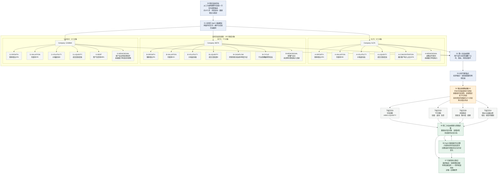
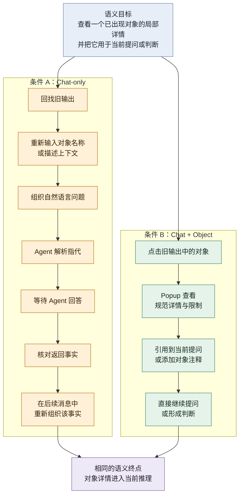

# 股票探索实验场景示意图 V4

> 状态：历史图示，已被 [V5 风险披露触发版图示](./stock-scenario-diagram-v5.md) 替代  
> 对应文档：[股票探索场景与实验剧本 V4](./stock-scenario-math-aligned-v4.md)  
> 核心原则：两个条件共享同一信息图 `G=(V,E)`、同一事实池和同一可接受终点，只改变语义边的交互实现与遍历成本。

## 图 1｜整个股票探索场景



### 读图要点

- `S0—S7` 是七个固定语义节点，不是强制七轮 Chat；自然语言往返数量允许因条件和参与者路径而变化。
- 19 个领域对象及其详情在两条件中完全一致，数值只是相应 Metric 对象的属性。
- `S4` 之后存在多个合理的下一步，用户不必按照固定次序探索。
- 最终没有唯一正确股票；评分关注事实准确性、更新后约束的一致性和风险覆盖。

## 图 2｜同一语义边的两种交互实现



## 图 3｜实验条件边界

```text
共同保持不变
├─ 高层任务目标
├─ 19个对象与全部规范事实
├─ 初始Agent概览与中途触发器
├─ 模型版本、系统提示和生成参数
├─ 可接受最终状态与评分规则
└─ Chat本身始终可用

唯一核心操纵
├─ Chat-only：对象是普通文本，局部详情和对象指代通过Chat完成
└─ Chat + Object：对象具有点击目标，可Popup展开、引用和添加对象注释
```

这三张图共同表达的 Claim 边界是：

> 两个条件在相同信息图上到达相同语义终点；Chat + Object 的潜在优势来自局部信息边的遍历成本降低，而不是额外信息、特殊推荐、看板式状态管理或更优的底层模型。
