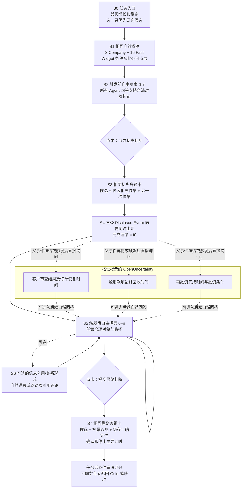
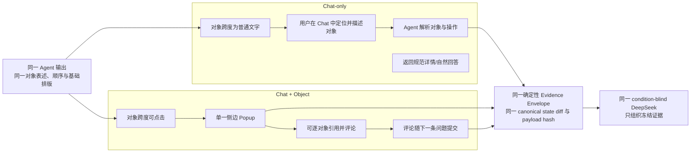
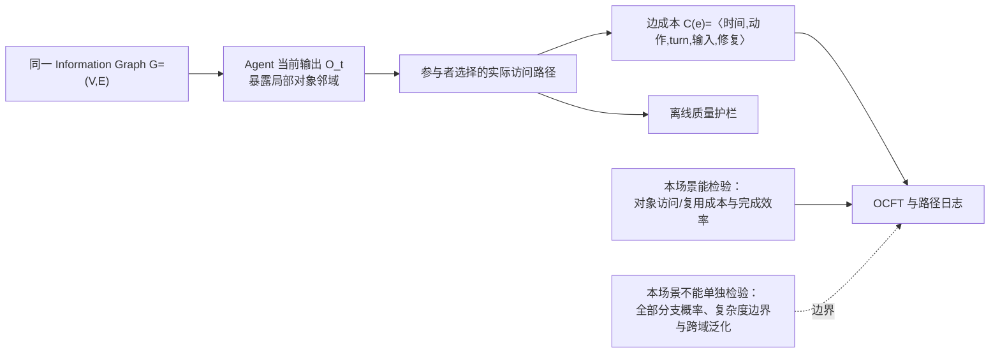

# 股票探索实验场景示意图 V5.1｜风险披露触发版（冻结）

> 本图集与 `stock-scenario-risk-disclosure-v5.md`、`stock-object-registry-v5.md` 共同构成 V5.1 合同。图中的 S0–S7 是语义节点，不是固定八轮。

## 图 1｜完整场景、信息变迁与终点



读图要点：

- 对象总数为 25：3 Company + 16 Fact + 3 DisclosureEvent + 3 OpenUncertainty。
- S5/S6 不是强制的 Event→detail→Fact→relation 管线，只表示自由探索中可能出现的路径。
- 普通 Chat、点击、引用、关键词和 LLM 输出都不会推进阶段；只有两个相同按钮打开固定答题卡，确认答题卡才推进阶段。
- 两条件答题卡不列事实清单、不预填答案，只统一提交字段和结构校验。
- `t0→第一次正式最终提交` 是主要完成时间；答得是否充分在任务后盲评。

## 图 2｜同一信息图，两种访问机制



两条件可因历史交互路径不同而出现不同的后续措辞；控制变量是事实宇宙、Envelope、模型配置和 reducer 语义，而非逐字输出。

## 图 3｜交互页面骨架（UI 视觉保持不变）

```text
┌──────────────┬──────────────────────────────────────────────────────┐
│ Codex 风格侧栏 │  比较三只候选股票                       模型状态       │
│              ├──────────────────────────────────────────────────────┤
│ 当前会话      │  用户任务                                            │
│              │                                                       │
│              │  Agent 自然回答：                                     │
│              │  ……BETA……24×市盈率……行业周期敏感性……                 │
│              │       └─ Chat+Object 中合格对象可点击                  │
│              │                                                       │
│              │                         ┌────────────────────────┐    │
│              │                         │ 小型单一资料 Popup       │    │
│              │                         │ 规范详情                 │    │
│              │    ┌──────────────┐     │ 引用并评论 / 取消引用    │    │
│              │    │ 对象旁单独评论 │◀────└────────────────────────┘    │
│              │    └──────────────┘                                  │
│              │                                                       │
│              │  ┌──────────────────────────────────────────────┐     │
│              │  │ 输入自然问题                         ↑       │     │
│              │  │ 4 引用（可展开、查看、取消）                  │     │
│              │  │ [形成初步判断] 或 [提交最终判断]              │     │
│              │  └──────────────────────────────────────────────┘     │
│              │                         ┌────────────────────────┐    │
│              │                         │ 相同固定答题卡           │    │
│              │                         │ 候选 + 两个文本字段      │    │
│              │                         │ 返回探索 / 确认并提交    │    │
│              │                         └────────────────────────┘    │
└──────────────┴──────────────────────────────────────────────────────┘
```

本图只增加冻结流程所需的轻量阶段按钮与两条件相同的紧凑答题卡；侧栏、对话流、输入框、单一资料 Popup 和注释交互沿用现有 UI。答题卡打开时普通 Composer 暂时禁用，不存在持久策略、Focus、Evidence 或“关联到当前判断”面板。

## 图 4｜理论量与本场景观测的对应



论文写作中应把本场景作为总 Claim 的一个机制证据，而不是把一个 composite episode 的多条边当作多个独立实验样本。
